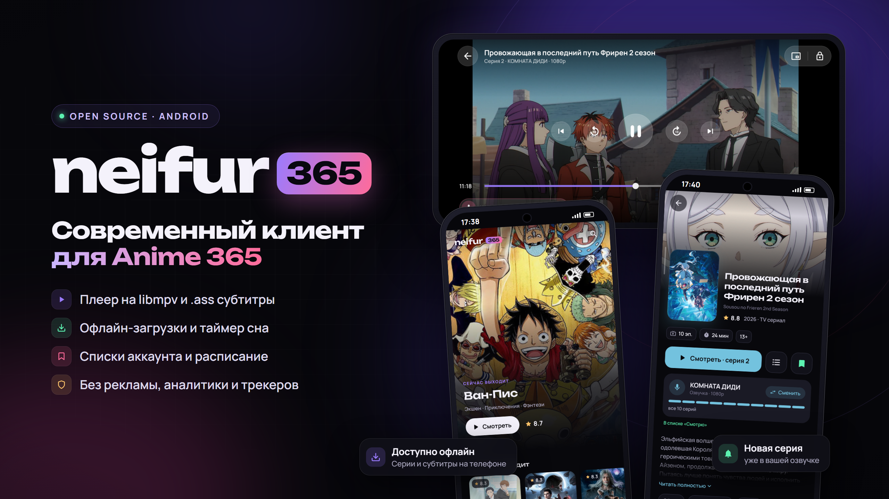
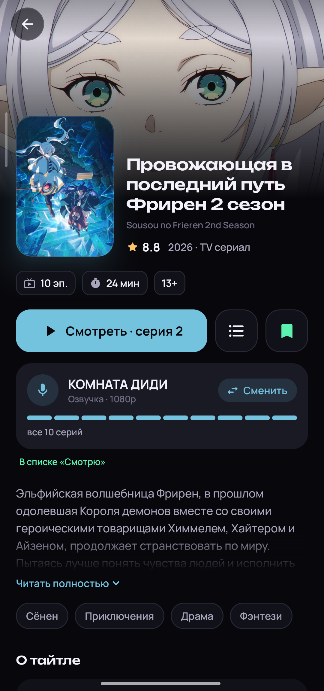
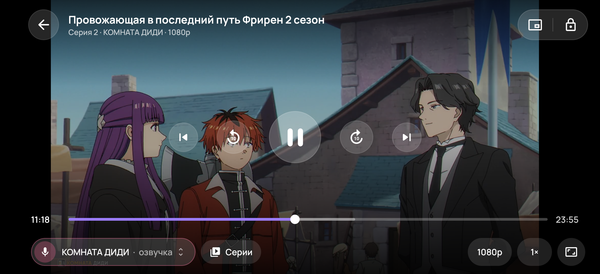

<p align="center">
  
</p>

<h1 align="center">Neifur 365</h1>

<p align="center">
  Неофициальный Android-клиент для <strong>Anime 365</strong> и <strong>Shikimori</strong>.<br/>
  Kotlin + Jetpack Compose, плеер на <code>libmpv</code>, офлайн-загрузки и открытый исходный код — без рекламы и трекеров.
</p>

<p align="center">
  <a href="https://github.com/kovidoff/Neifur365/releases/latest">
    
  </a>
  <a href="https://github.com/kovidoff/Neifur365/actions/workflows/ci.yml">
    
  </a>
  
  
  <a href="LICENSE">
    
  </a>
</p>

<p align="center">
  <a href="https://github.com/kovidoff/Neifur365/releases/latest"><strong>Скачать APK</strong></a>
  &nbsp;·&nbsp;
  <a href="https://t.me/neifur365">Telegram-канал</a>
  &nbsp;·&nbsp;
  <a href="https://github.com/kovidoff/Neifur365/issues">Сообщить о баге</a>
  &nbsp;·&nbsp;
  <a href="#приватность-и-безопасность">Приватность</a>
</p>

---

## Возможности

<table>
  <tr>
    <td valign="top" width="50%">
      <strong>Плеер на <code>libmpv</code></strong><br/>
      Выбор качества, озвучек и <code>.ass</code> субтитров прямо в плеере, скорость воспроизведения, режимы кадра, жесты яркости и громкости, пропуск опенинга (<code>+85 с</code>), таймер сна, PiP и управление с наушников.
    </td>
    <td valign="top" width="50%">
      <strong>Офлайн-просмотр</strong><br/>
      Фоновая загрузка серий (по одной или пакетом <code>+3 серии</code>) вместе с субтитрами, выбор качества для скачивания, автоудаление просмотренных и быстрый доступ без интернета.
    </td>
  </tr>
  <tr>
    <td valign="top" width="50%">
      <strong>Списки и любимые студии</strong><br/>
      Синхронизация всех списков с аккаунтом Anime 365, поиск и сортировка внутри вкладок, быстрое редактирование по долгому нажатию, запоминание студии для тайтла и приоритет избранных озвучек.
    </td>
    <td valign="top" width="50%">
      <strong>Каталог, расписание и уведомления</strong><br/>
      Фильтры по типу, статусу, жанру и году, отметки тайтлов из списков на постерах, расписание онгоингов на неделю по локальному времени, уведомления о новых сериях, автоподбор зеркал/каналов и диплинки.
    </td>
  </tr>
</table>

---

## Скриншоты

<p align="center">
  
  &nbsp;&nbsp;&nbsp;
  
</p>
<p align="center">
  
</p>

---

## Установка

1. Откройте [последний релиз](https://github.com/kovidoff/Neifur365/releases/latest) и скачайте файл `Neifur365-*.apk`.
2. Установите APK поверх предыдущей версии — настройки, история просмотра, загрузки и сессия сохранятся.

> [!IMPORTANT]
> Требуется **Android 8.0+** (`arm64-v8a`) и собственный аккаунт **Anime 365** с действующей подпиской — без неё сайт не отдаёт видеопотоки.

---

## Приватность и безопасность

У Neifur 365 **нет собственного сервера, телеметрии, рекламы и аналитики**. Все сетевые обращения открыты и проверяются в коде:

| Куда идут запросы | Зачем | Где в коде |
| --- | --- | --- |
| **Anime 365** (`smotret-anime.*` / `anime365.ru`) | Вход в аккаунт, списки, каталог, ссылки на серии и субтитры | [`Anime365.kt`](app/src/main/java/app/neifur/data/a365/Anime365.kt), [`SitePages.kt`](app/src/main/java/app/neifur/data/a365/SitePages.kt) |
| **Shikimori** (`shikimori.one` / `shikimori.io`) | Описания, оценки, персонажи, кадры и расписание онгоингов | [`Shikimori.kt`](app/src/main/java/app/neifur/data/shikimori/Shikimori.kt) |
| **AniSkip** (`api.aniskip.com`, только если включён в настройках) | Тайминги опенингов и эндингов по MAL ID | [`AniSkip.kt`](app/src/main/java/app/neifur/data/aniskip/AniSkip.kt) |
| **YouTube** (только при открытии трейлера / превью) | Превью и переход к трейлерам тайтла | [`DetailScreen.kt`](app/src/main/java/app/neifur/ui/screens/DetailScreen.kt) |

- Логин и пароль отправляются **напрямую** на Anime 365 и не сохраняются на телефоне (хранятся только session cookies в приватном `SharedPreferences` приложения).
- История просмотра, настройки и скачанные серии хранятся только локально на устройстве.

---

## Сборка из исходников

**Требования:** JDK 17 и Android SDK (`compileSdk 36`).

```bash
# Юнит-тесты
./gradlew testDebugUnitTest

# Debug APK (ставится рядом с релизом как «Neifur 365 Dev»)
./gradlew assembleDebug

# Release APK (с R8-оптимизацией)
./gradlew assembleRelease
```

> [!NOTE]
> Без собственного keystore `assembleRelease` подпишется debug-ключом. Для релизной подписи добавьте параметры в `local.properties` (файл в `.gitignore`):
>
> ```properties
> release.storeFile=/path/to/keystore.jks
> release.storePassword=...
> release.keyAlias=...
> ```

<details>
<summary><strong>Структура проекта</strong></summary>

```text
app/src/main/java/app/neifur/
├── core/        — HTTP-клиент (OkHttp), JSON, обработка ошибок
├── data/
│   ├── a365/    — клиент Anime 365, зеркала, каналы, списки, студии
│   └── shikimori/ — GraphQL-клиент Shikimori и расписание
├── downloads/   — менеджер офлайн-загрузок и Foreground Service
├── alerts/      — фоновая проверка новых серий (WorkManager)
├── player/      — интеграция libmpv, медиа-сессия, PiP, UI плеера
└── ui/          — тема, общие компоненты и экраны Compose
```

</details>

---

## Дисклеймер и лицензия

- **Neifur 365** — независимый неофициальный клиент. Проект не связан с администрацией **Anime 365** или **Shikimori**, не хранит и не распространяет видеоматериалы.
- Исходный код распространяется по лицензии **[GNU General Public License v3.0](LICENSE)**.
